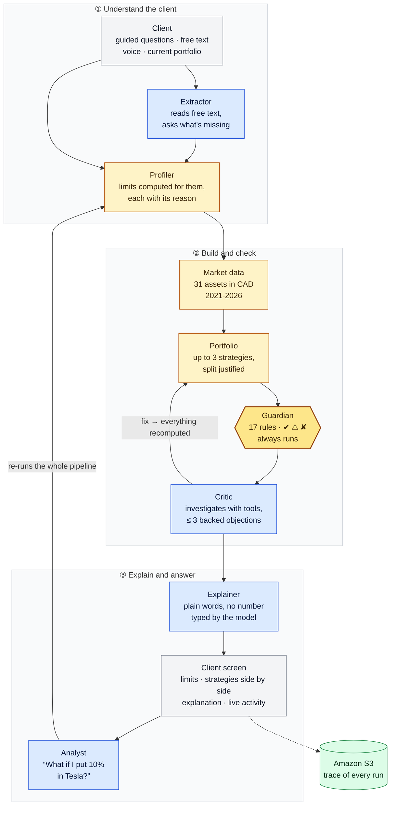
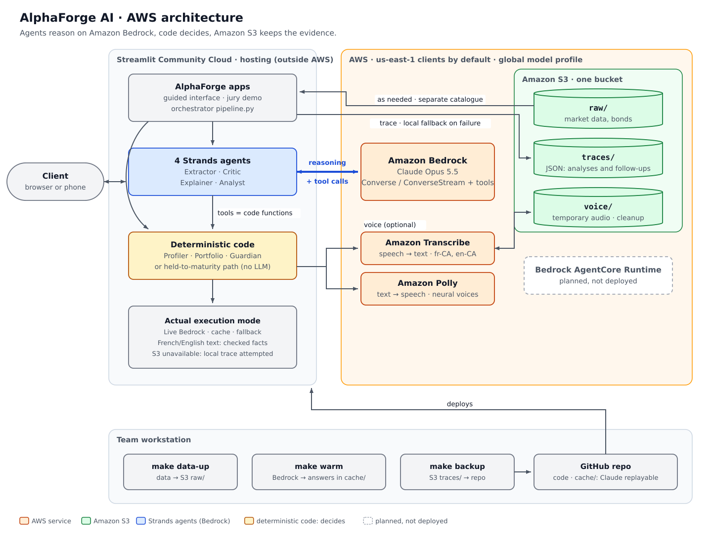

# AlphaForge AI

### An investment analyst that can say no, and shows why.

**Robert, 59, wants to put 25% of his portfolio in Tesla.** He accepts a loss of at most 15%.
AlphaForge AI finds that Tesla's worst drop over 2021-2026 was **−70.9%**: at 25%, Tesla alone would have cost
**−17.7%** of the portfolio, more than his whole loss limit. Tesla fits his limits up to **3.1%**.
The tool shows him the rule, the number and the source, then leaves the decision to him.

> **▶ Try the app: https://alphaforge-ai-wj.streamlit.app/** · French by default, Français ⇄ English switch
>
> [One-pager](deliverables/ONE_PAGER.en.md) · [Technical doc](deliverables/TECHNICAL_DOC.en.md) ·
> [Video script](deliverables/VIDEO_SCRIPT.en.md) · [AWS architecture](aws/AWS_ARCHITECTURE.en.md) ·
> [Agent architecture](aws/architecture.en.md) ·
> *Version française : [`README.md`](README.md)*

PolyFinances Datathon 2026 (Polytechnique Montréal) · challenge **AlphaForge AI**, **National Bank × AWS** ·
team William Caron-Bastarache and Joud Katbe

*Simulation only: fictional profiles, no real transactions, not financial advice.*

---

## In 30 seconds

| | |
|---|---|
| **The problem** | An investor can see every price, but not what a portfolio means *for them*: how much they can lose, how much time they have, whether the hyped stock suits them. A chat assistant left to itself answers with a polite "yes" or an invented number. |
| **Our answer** | A team of agents that does what a good Canadian advisor would: build the profile, propose up to **3 strategies** that respect the client's limits, decline what doesn't fit, and **justify every number**. |
| **The principle** | **Agents investigate and argue, code enforces.** Four Strands agents on Amazon Bedrock (Claude Opus 5.5) choose what to check and how to explain it; every limit and every number comes from code, and a **17-rule** Guardian always runs. |
| **The proof** | **16/16** trap test profiles pass (`make scenarios`) · **400+** offline tests (`make test`) · every run leaves a full trace in **Amazon S3**. |

## How it works



**Blue:** Strands agents on Amazon Bedrock (Claude Opus 5.5) · **Yellow:** deterministic code, where decisions are
made · **Green:** AWS · Detailed diagram (tools, checks, failure paths): [`aws/architecture.en.md`](aws/architecture.en.md)

An agent decides *inside* its step, never which step comes next: `pipeline.py` fixes the order so the Guardian can
never be bypassed. If an agent fails or AWS doesn't answer, a deterministic version takes over and the trace says so.

## Two-minute tour

In the [app](https://alphaforge-ai-wj.streamlit.app/) (switch to English at the top if you prefer):

1. **Welcome → "Try with an example client"**, then **Run the analysis**. The pipeline graph fills in live, agent
   by agent.
2. **Your results**: your limits with their reasons, then up to three strategies **side by side** (worst past drop,
   2022, chance of ending below what you put in, what set the split).
3. **Activity**: every hand-off between agents, the Critic's tool calls, the Guardian's verdicts, and where the
   evidence was saved (Amazon S3).
4. **Assistant**: "What if I put 10% in Tesla?". The Analyst re-runs the whole pipeline with that position and answers
   with the numbers it got.
5. **"I already have a portfolio"**: enter your holdings (or "Try an example portfolio") for a critique in numbers and
   a rebuild, in dollars, towards a strategy that fits.

## What sets it apart

| | In practice |
|---|---|
| **No invented numbers** | The Explainer never types a figure: it writes placeholders (`{n7}`) that code fills with computed values. The Critic's and Analyst's numbers must come from the tools they cite. A text that fails is replaced by a checked template, and the trace says so. |
| **A Critic that checks before it objects** | Up to 6 tool calls (correlations, each holding's share of risk, the 2022 crisis…) and at most 3 objections, each backed by a result. A fix re-runs the whole calculation and the Guardian re-checks; if it breaks a limit, the original stays. |
| **Limits specific to each client** | No table of standard profiles: loss limit (in % and $), defensive floor, per-company cap, computed for the client, each with its written reason, and every score placed on its 1-to-5 scale. Each strategy says which constraint set its split. |
| **Modelled on Canadian regulation** | The Guardian's rules follow Canadian know-your-client and suitability duties (NI 31-103). They are modelled on them, not a legal compliance test. |
| **Useful to a real client** | Guided questions or a free description, review of a portfolio already held (fees in $, moves in $), lookup of bonds held to maturity, the whole app in French or English (interface, results and Claude's texts), optional voice. |
| **Honest about its choices** | We tested a Markowitz optimiser and a protected strategy (CPPI), then set them aside with evidence: the "optimal" weights changed with the period and did not beat equal weights out of sample. No past return is presented as a forecast. |

## AWS: a real job for every service

[](aws/AWS_ARCHITECTURE.en.md)

*Each service's calls and data: [`aws/AWS_ARCHITECTURE.en.md`](aws/AWS_ARCHITECTURE.en.md).*

| Service | What it does in AlphaForge |
|---|---|
| **Amazon Bedrock** (Claude Opus 5.5) | powers the four agents: Extractor, Critic, Explainer, Analyst |
| **Strands Agents SDK** | gives each agent its deterministic tools and its call loop, capped and traced |
| **Amazon S3** | keeps the full trace of every run (profile, limits, strategies, checks, text) and serves the data to the hosted app |
| **Amazon Transcribe and Amazon Polly** | optional voice in the guided interface: describe your situation aloud, hear the answer |

Claude's answers for the demo clients are saved in the repo (`cache/`): the app keeps replaying them after the event's
AWS account closes, and says so on screen.

## Full example: Robert

| | Result (2021-2026 data, `results.csv`) |
|---|---|
| Loss limit | 15%, i.e. 60,000 $ of 400,000 $ (the more cautious of what he accepts and what his situation allows) |
| Request | 25% in Tesla: worst drop −70.9%, would cost −17.7% of the portfolio on its own; fits his limits up to 3.1% |
| Strategy 1 | 15% in stocks; worst past drop −8.6%; 2022: −5.8%; split set by his 4-year horizon |
| Strategy 2 | 5% in stocks; worst past drop −7.7% |
| Guardian | both strategies pass; Tesla is in neither; the request is explained, not quietly applied |

## Validation

- **16 test profiles** with expected verdicts, including traps (a beginner asking for 100% Bitcoin, a 2-year horizon
  with a high risk appetite, an explanation with an invented number): **16/16** (`make scenarios`).
- **400+ offline tests** (`make test`), including each agent's controls: an unbacked number is dropped, a fix that
  breaks a limit is reverted, an AWS error falls back to the deterministic version.
- **Stand-ins checked**: a fund without data is measured with a labelled stand-in; against real prices, the gap on the
  worst drop is ±0.4 points (1 to 3 points for CAD-hedged funds, disclosed on screen).

## Stated limitations

- The numbers describe 2021-2026 (one mild bear market): they are not forecasts.
- The horizon rule (no stocks at 2 years, no cap from 15 years) is a team judgment, presented as such.
- The simulated loss model rests on stated assumptions (3% premium, 10% threshold), not on a guarantee.
- Fees shown but not deducted; no taxes or account types (TFSA/RRSP); one goal at a time.

Details, sources and assumptions: [technical doc](deliverables/TECHNICAL_DOC.en.md).

---

## Quick start

Requires Python 3.12+ and internet access (to build the data).

```bash
make setup        # venv + dependencies + .env (fill it in)
make data         # starter CSVs into data/raw/
make check        # per-asset return / volatility / Sharpe / drawdown
make scenarios    # 16 test profiles through Profiler + Guardian, every hand-off printed
make explain P=robert   # full pipeline + Explainer on a persona (amira, mateo, robert); trace saved to S3
make test         # offline tests
make extract T="I'm 59, ..."   # free text → profile + follow-up questions
make bedrock-check  # AWS smoke test: region, credentials, Bedrock text + tool use, S3 (needs .env)
make app          # the demo (jury view) on http://localhost:8501: limits, strategies, explanation, Analyst, trace
make ui           # guided interface (client view) on http://localhost:8502: same engine, step-by-step questions
make warm         # with Bedrock: fill every demo cache in one run (DRY=1 lists the calls)
```

**Both views include a Light / Dark appearance switch and live analysis hand-offs.** Clients can inspect their
completed run in Activity; judges can inspect Activity & evidence, including checks, sources, explanation origin,
and the actual S3/local storage outcome. Activity also lists and searches the currently enabled product universe.

**Risk model (release integration).** The growth ceiling uses a stationary block bootstrap over the client's horizon, with a stated 3% annual premium on growth assets above cash and a 10% model exceedance threshold. A fresh simulation checks the final weights. These are scenario assumptions, not a calibrated guarantee of future losses. G17 is folded into G7; G18 checks result consistency; research-mode dividend warnings use G19. See `notes/risk-architecture.md`.

**Two front ends, one engine.** `make app` is the demo: it shows everything the agents did (limits with reasons,
strategies and what set each split, Guardian checks, the Explainer's text, follow-ups, the full trace) and saves
each run's trace to Amazon S3. `make ui` is what a client would use: questions one at a time, results
essentials-first, the Analyst as a conversation. Both call the same `pipeline.run`; neither computes a number.

Windows without `make`:

```bash
python -m venv .venv && .venv\Scripts\python -m pip install -e ".[dev,agents]"
copy Datathon2026Infos\alphaforge_starter\build_dataset.py data\raw\ && .venv\Scripts\python data\raw\build_dataset.py
.venv\Scripts\python -m dh check
.venv\Scripts\python -m dh scenarios -v
.venv\Scripts\python -m dh explain robert
set LLM_PROVIDER=mock && .venv\Scripts\python -m pytest -q
.venv\Scripts\python -m streamlit run app/app.py
```

### Configuration (`.env`, never committed)

| Variable | Use |
|---|---|
| `LLM_PROVIDER` | `mock` (offline, default) or `bedrock` |
| `BEDROCK_MODEL_ID` | Bedrock model for the LLM agents (verified on the event account: `global.anthropic.claude-opus-5-5`) |
| `BEDROCK_EXPLAINER_MODEL_ID` | optional override for the Explainer (default `global.anthropic.claude-opus-5-5`) |
| `AWS_REGION` | e.g. `us-east-1` |
| `S3_BUCKET` | bucket for run traces (`traces/`) and data (`raw/`, `make data` can sync from it) |

AWS credentials come from your AWS profile (`aws configure`), not from this repo. LLM calls go through
`dh.llm.ask` (cached in `.cache/llm/`), except the Strands Explainer, which caches its own answers; the three
personas' Opus texts are committed in `cache/explainer/`, matching facts replay without AWS; otherwise offline mode uses an explicitly labelled deterministic fallback. Run `make warm` on the final code and dataset before recording.

## Deploy (Streamlit Community Cloud)

The data never goes in git (decision #11). A hosted copy gets it at first start: from the team's S3 bucket, else by
rebuilding it with the organizers' script (`src/dh/bootstrap.py`).

1. Once, from a laptop with the data and `.env`: `make data-up` (uploads `data/raw/*.csv` to `s3://$S3_BUCKET/raw/`).
2. On https://share.streamlit.io: **New app** → this repo, branch `main`, file `interface/app.py` (guided
   interface) or `app/app.py` (demo view); **Advanced settings** → Python 3.12. Deploy each app separately if both.
3. **Secrets** (same box for each app; never in git):
   ```toml
   AF_AUTO_DATA = "1"
   S3_BUCKET = "…"
   AWS_REGION = "us-east-1"
   AWS_ACCESS_KEY_ID = "…"
   AWS_SECRET_ACCESS_KEY = "…"
   AWS_SESSION_TOKEN = "…"
   LLM_PROVIDER = "bedrock"
   AF_LANG = "fr"           # interface language at start: "fr" (default) or "en"; a sidebar switch changes it
   AF_VOICE_ENABLED = "0"   # "1" turns on voice in the guided interface (Amazon Transcribe + Polly, audio via S3 voice/)
   ```
   After the event account closes, set `LLM_PROVIDER = "mock"` and remove the AWS keys: the app rebuilds the data
   itself and replays the cached Claude answers (offline mode, said on screen).

## Data

| Source | What | Where |
|---|---|---|
| Starter pack (organizers) | 31 assets, daily prices 2021-11-12 → 2026-11-12, dividends/splits, USD/CAD, rates, CPI | Yahoo Finance, Bank of Canada, FRED; rebuilt by `Datathon2026Infos/alphaforge_starter/build_dataset.py` |
| ETF holdings | what SPY, QQQ, ESGV and XIU actually hold, for look-through | issuer files (State Street, Invesco, Vanguard, iShares); `scripts/build_holdings.py`. SPY loaded (as of 2026-11-12); the others still to download |

Prices in each asset's currency, converted to CAD (`harness.toml`); returns from adjusted close. Known limits:
survivorship bias in the universe, monthly macro data dated by reference month (lagged before use), holdings are a
snapshot used for exposure only. Historical numbers describe the past; they are not predictions.
Sources, dates, processing and terms: [`data/README.md`](data/README.md). Data files are never committed.

## Repository layout

```
src/dh/            data.py (loaders, FX, calendar) · metrics.py (risk stats, look-through, results log)
                   quant_toolkit.py (risk, stress, bootstrap) · holdings.py (ETF holdings) · tracestore.py (S3 traces)
                   llm.py (mock | Bedrock, cached) · personas.py
src/dh/agents/     profiler.py · market.py · market_charts.py · portfolio.py · diversification.py · checks.py
                   guardian.py · explainer.py · pipeline.py · trace.py · rules.py · scenarios.py
app/app.py         demo app (Streamlit)
aws/               architecture graph
cache/explainer/   committed Opus texts for the three personas (offline demo)
outputs/traces/    run traces pulled from S3 by `make backup`
scripts/           get-data, build_holdings, bedrock_check, backup, scan-secrets, worktrees
notes/             design, contract, decisions, branch docs, intake form, kickoff notes
deliverables/      one-pager, technical doc, video script
Datathon2026Infos/ official brief, slides, starter-pack script
tests/             offline tests
```

## Working on this repo

Team rules (lanes, one data path, results log, branch design docs, secrets): [`CLAUDE.md`](CLAUDE.md).
Facts, verified vs assumed: [`CONTEXT.md`](CONTEXT.md). Coding agents: read both before doing anything.

A guard hook (`.claude/hooks/guard_bash.py`) stops coding agents from reading secrets, force-pushing or deleting cloud
resources. It's a speed bump, not a security boundary. Run `make scan` before making the repo public, and
`make backup` before the Sunday 23:59 freeze (nothing can be pushed after it; the AWS account closes Monday 13:59).

## License

MIT, see [`LICENSE`](LICENSE).
