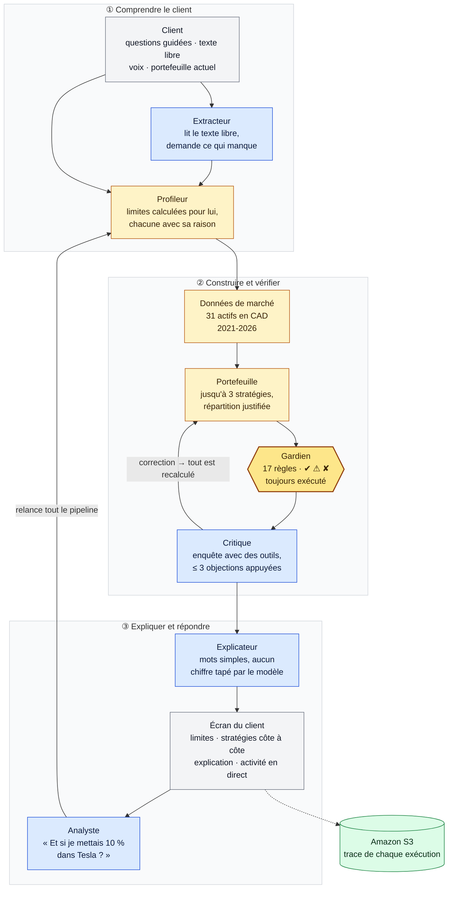

# AlphaForge AI

### Un analyste en placement qui sait dire non, et qui montre pourquoi.

**Robert, 59 ans, veut mettre 25 % de son portefeuille dans Tesla.** Il accepte de perdre au plus 15 %.
AlphaForge AI calcule que la pire baisse de Tesla sur 2021-2026 a été de **−70,9 %** : à 25 %, Tesla seule aurait
coûté **−17,7 %** du portefeuille, plus que toute sa limite de perte. Tesla entre dans ses limites jusqu'à **3,1 %**.
L'outil lui montre la règle, le nombre et la source, puis lui laisse la décision.

> **▶ Essayer l'application : https://alphaforge-ai-wj.streamlit.app/** · français par défaut, bouton Français ⇄ English
>
> [Fiche d'une page](deliverables/ONE_PAGER.md) · [Documentation technique](deliverables/TECHNICAL_DOC.md) ·
> [Évaluation chiffrée](deliverables/EVALUATION.md) · [Script de la vidéo](deliverables/VIDEO_SCRIPT.md) · [Architecture AWS](aws/AWS_ARCHITECTURE.md) ·
> [Architecture des agents](aws/architecture.md) ·
> *English: [`README.en.md`](README.en.md)*

Datathon PolyFinances 2026 (Polytechnique Montréal) · défi **AlphaForge AI**, **Banque Nationale × AWS** ·
équipe William Caron-Bastarache et Joud Katbe

*Simulation seulement : profils fictifs, aucune transaction réelle, pas un conseil financier.*

---

## En 30 secondes

| | |
|---|---|
| **Le problème** | Un investisseur voit tous les prix, mais pas ce qu'un portefeuille signifie *pour lui* : combien il peut perdre, de combien de temps il dispose, si l'action à la mode lui convient. Un assistant conversationnel laissé à lui-même répond par un « oui » poli ou un chiffre inventé. |
| **Notre réponse** | Une équipe d'agents qui fait ce que ferait un bon conseiller canadien : établir le profil, proposer jusqu'à **3 stratégies** qui respectent ses limites, refuser ce qui ne convient pas, et **justifier chaque nombre**. |
| **Le principe** | **Les agents enquêtent et argumentent, le code fait respecter.** Quatre agents Strands sur Amazon Bedrock (Claude Opus 5.5) choisissent quoi vérifier et comment l'expliquer; chaque limite et chaque nombre viennent du code, et un Gardien de **17 règles** s'exécute toujours. |
| **La preuve** | **16/16** profils de test piégés passent (`make scenarios`) · **400+** tests hors ligne (`make test`) · chaque exécution laisse une trace complète dans **Amazon S3**. |

## Comment ça fonctionne



**Bleu :** agents Strands sur Amazon Bedrock (Claude Opus 5.5) · **Jaune :** code déterministe, où se prennent les
décisions · **Vert :** AWS · Diagramme détaillé (outils, contrôles, chemins d'erreur) : [`aws/architecture.md`](aws/architecture.md)

Un agent décide *à l'intérieur* de son étape, jamais de l'étape suivante : l'ordre est fixé par `pipeline.py`, pour que
le Gardien ne puisse jamais être contourné. Si un agent échoue ou qu'AWS ne répond pas, une version déterministe prend
le relais et la trace le dit.

## Visite de deux minutes

Dans l'[application](https://alphaforge-ai-wj.streamlit.app/) :

1. **Accueil → « Essayer avec un client fictif »**, puis **Lancer l'analyse**. Le graphe du pipeline se remplit en
   direct, agent par agent.
2. **Vos résultats** : vos limites avec leurs raisons, puis jusqu'à trois stratégies **côte à côte** (pire baisse
   passée, année 2022, chance de finir sous la mise, ce qui a fixé la répartition).
3. **Activité** : chaque relais entre agents, les appels d'outils du Critique, les verdicts du Gardien, et l'endroit
   où la preuve a été enregistrée (Amazon S3).
4. **Assistant** : « Et si je mettais 10 % dans Tesla ? ». L'Analyste relance tout le pipeline avec cette position et
   répond avec les nombres obtenus.
5. **« J'ai déjà un portefeuille »** : saisir ses placements (ou « Essayer un portefeuille fictif ») pour une critique
   chiffrée et la reconstruction, en dollars, vers une stratégie qui convient.

## Ce qui nous distingue

| | En pratique |
|---|---|
| **Aucun nombre inventé** | L'Explicateur n'écrit jamais un chiffre : il place des repères (`{n7}`) que le code remplit avec les valeurs calculées. Les nombres du Critique et de l'Analyste doivent venir des outils qu'ils citent. Un texte qui échoue est remplacé par un gabarit vérifié, et la trace le dit. |
| **Un Critique qui vérifie avant d'objecter** | Jusqu'à 6 appels d'outils (corrélations, part de risque de chaque placement, crise de 2022…) et au plus 3 objections, chacune appuyée par un résultat. Une correction relance tout le calcul et le Gardien revérifie; si elle enfreint une limite, l'original reste. |
| **Des limites propres à chaque client** | Pas de table de profils types : limite de perte (en % et en $), plancher défensif, plafond par société, calculés pour le client, chacun avec sa raison écrite, et chaque score situé sur son échelle de 1 à 5. Chaque stratégie dit quelle contrainte a fixé sa répartition. |
| **Calqué sur la réglementation canadienne** | Les règles du Gardien reprennent les obligations de connaissance du client et de convenance (Règlement 31-103). Elles s'en inspirent, ce n'est pas un test de conformité légale. |
| **Utile au vrai client** | Questions guidées ou description libre, revue du portefeuille qu'on détient déjà (frais en $, mouvements en $), recherche d'obligations détenues jusqu'à l'échéance, application entièrement en français ou en anglais (interface, résultats et textes de Claude), voix facultative. |
| **Honnête sur ses choix** | Nous avons testé un optimiseur de Markowitz et une stratégie protégée (CPPI), puis les avons écartés, preuves à l'appui : les pondérations « optimales » changeaient avec la période et ne battaient pas l'équipondération hors échantillon. Aucun rendement passé n'est présenté comme une prévision. |

## AWS : un vrai rôle pour chaque service

[](aws/AWS_ARCHITECTURE.md)

*Détails, appels et données de chaque service : [`aws/AWS_ARCHITECTURE.md`](aws/AWS_ARCHITECTURE.md).*

| Service | Ce qu'il fait dans AlphaForge |
|---|---|
| **Amazon Bedrock** (Claude Opus 5.5) | fait raisonner les quatre agents : Extracteur, Critique, Explicateur, Analyste |
| **Strands Agents SDK** | donne à chaque agent ses outils déterministes et sa boucle d'appels, plafonnée et tracée |
| **Amazon S3** | conserve la trace complète de chaque exécution (profil, limites, stratégies, contrôles, texte) et fournit les données à l'application hébergée |
| **Amazon Transcribe et Amazon Polly** | voix facultative dans l'interface guidée : dicter sa situation, écouter la réponse |

Les réponses de Claude pour les clients de démonstration sont enregistrées dans le dépôt (`cache/`) : l'application
continue de les rejouer après la fermeture du compte AWS de l'événement, et l'indique à l'écran.

## Exemple complet : Robert

| | Résultat (données 2021-2026, `results.csv`) |
|---|---|
| Limite de perte | 15 %, soit 60 000 $ sur 400 000 $ (la plus prudente de ce qu'il accepte et de ce que sa situation permet) |
| Demande | 25 % dans Tesla : pire baisse −70,9 %, coûterait à elle seule −17,7 % du portefeuille; entre dans ses limites jusqu'à 3,1 % |
| Stratégie 1 | 15 % en actions; pire baisse passée −8,6 %; 2022 : −5,8 %; répartition fixée par son horizon de 4 ans |
| Stratégie 2 | 5 % en actions; pire baisse passée −7,7 % |
| Gardien | les deux stratégies passent; Tesla n'est dans aucune; la demande est expliquée, pas appliquée en douce |

## Validation

- **16 profils de test** avec verdicts attendus, dont des pièges (un débutant qui veut 100 % de bitcoin, un horizon de
  2 ans avec un fort appétit pour le risque, une explication avec un nombre inventé) : **16/16** (`make scenarios`).
- **Plus de 400 tests hors ligne** (`make test`), y compris les contrôles de chaque agent : un nombre non appuyé est
  retiré, une correction qui enfreint une limite est annulée, une erreur AWS bascule vers la version déterministe.
- **Substituts vérifiés** : un fonds sans données est mesuré par un substitut identifié; contre les vrais prix, l'écart
  sur la pire baisse est de ±0,4 point (1 à 3 points pour les fonds couverts en CAD, divulgué à l'écran).

## Limites assumées

- Les nombres décrivent 2021-2026 (un seul marché baissier modéré) : ce ne sont pas des prévisions.
- La règle d'horizon (aucune action à 2 ans, aucun plafond à 15 ans) est un jugement de l'équipe, présenté comme tel.
- Le modèle de perte simulé repose sur des hypothèses déclarées (prime de 3 %, seuil de 10 %), pas sur une garantie.
- Frais montrés mais non déduits; pas d'impôts ni de types de comptes (CELI/REER); un seul objectif à la fois.

Détails, sources et hypothèses : [documentation technique](deliverables/TECHNICAL_DOC.md).

---

<details>
<summary><b>Installer et lancer en local</b></summary>

Exige Python 3.12+ et un accès Internet (pour construire les données).

```bash
make setup        # environnement virtuel + dépendances + .env (à remplir)
make data         # données du jeu de départ dans data/raw/
make ui           # interface guidée (vue client) : http://localhost:8502
make app          # démonstration (vue du jury) : http://localhost:8501
make scenarios    # 16 profils de test, chaque relais affiché
make test         # tests hors ligne
make explain P=robert   # pipeline complet sur un persona (amira, mateo, robert); trace dans S3
make warm         # avec Bedrock : enregistre les réponses de démonstration
```

Windows sans `make` :

```bash
python -m venv .venv && .venv\Scripts\python -m pip install -e ".[dev,agents]"
copy Datathon2026Infos\alphaforge_starter\build_dataset.py data\raw\ && .venv\Scripts\python data\raw\build_dataset.py
set LLM_PROVIDER=mock && .venv\Scripts\python -m pytest -q
.venv\Scripts\python -m streamlit run interface/app.py
```

Configuration (`.env`, jamais versionné) : `LLM_PROVIDER` (`mock` hors ligne ou `bedrock`), `BEDROCK_MODEL_ID`
(`global.anthropic.claude-opus-5-5`), `AWS_REGION`, `S3_BUCKET`, `AF_LANG` (`fr` ou `en`). Les identifiants AWS
viennent de votre profil AWS, jamais de ce dépôt.
</details>

<details>
<summary><b>Déployer sur Streamlit Community Cloud</b></summary>

Les données ne vont jamais dans git. Au premier démarrage, l'application les prend dans le compartiment S3 de l'équipe,
sinon les reconstruit avec le script des organisateurs, sur la période du jeu de départ (2021-11-12 → 2026-11-12).

1. Une fois, depuis un ordinateur qui a les données : `make data-up` (téléverse `data/raw/` dans `s3://$S3_BUCKET/raw/`).
2. Sur https://share.streamlit.io : **New app** → ce dépôt, branche `main`, fichier `interface/app.py` (ou `app/app.py`
   pour la démonstration); Python 3.12.
3. **Secrets** :
   ```toml
   AF_AUTO_DATA = "1"
   S3_BUCKET = "…"
   AWS_REGION = "us-east-1"
   AWS_ACCESS_KEY_ID = "…"
   AWS_SECRET_ACCESS_KEY = "…"
   AWS_SESSION_TOKEN = "…"
   LLM_PROVIDER = "bedrock"
   AF_LANG = "fr"
   AF_VOICE_ENABLED = "0"   # "1" active la voix (Amazon Transcribe + Polly)
   ```
   Après la fermeture du compte AWS : `LLM_PROVIDER = "mock"` et retirer les clés; l'application rejoue les réponses
   enregistrées de Claude.
</details>

<details>
<summary><b>Données et sources</b></summary>

| Source | Contenu | Provenance |
|---|---|---|
| Jeu de départ (organisateurs) | 31 actifs, prix quotidiens 2021-11-12 → 2026-11-12, dividendes, USD/CAD, taux, IPC | Yahoo Finance, Banque du Canada, FRED (`Datathon2026Infos/alphaforge_starter/build_dataset.py`) |
| Avoirs des FNB | ce que les FNB détiennent réellement, pour compter une société une seule fois | fichiers des émetteurs (SPY au 2026-11-12) |
| Obligations | titres gouvernementaux canadiens et américains, détenus jusqu'à l'échéance | sources publiques datées (`data/README.md`) |

Tout est converti en CAD; rendements sur le cours ajusté. Limites : biais du survivant dans l'univers, avoirs = un
instantané. Sources, dates, traitement et conditions : [`data/README.md`](data/README.md).
</details>

<details>
<summary><b>Organisation du dépôt</b></summary>

```
interface/         interface guidée (vue client)
app/app.py         démonstration (vue du jury)
src/dh/agents/     profiler · market · portfolio · checks · guardian · critic · explainer · analyst · extractor
                   existing (portefeuille déjà détenu) · fixed_income · pipeline · trace · rules · scenarios
src/dh/            données, statistiques de risque, traces S3, Français ⇄ English (i18n)
aws/               architecture (français; anglais : *.en.md)
deliverables/      fiche d'une page, documentation technique, script vidéo (français; anglais : *.en.md)
cache/             réponses enregistrées de Claude (démonstration sans AWS)
notes/             conception, contrat entre agents, journal des décisions (notes de l'équipe, en anglais)
tests/             tests hors ligne
```
</details>

## Licence

MIT, voir [`LICENSE`](LICENSE).
