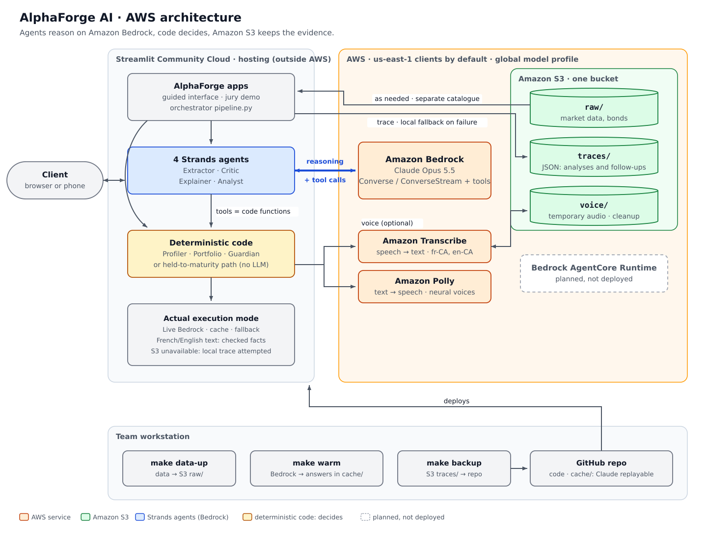

# AlphaForge AI: AWS architecture

The **Streamlit application is hosted outside AWS**. Its Python process orchestrates agents with the **Strands
SDK**, calls **Amazon Bedrock** for language tasks, and uses **Amazon S3** for data and run evidence. **Amazon
Transcribe** and **Amazon Polly** provide optional voice assistance. Financial calculations and rules run in the
application’s deterministic code.

AWS clients use `AWS_REGION`, defaulting to **`us-east-1`**. The default model is the **global** inference profile
`global.anthropic.claude-opus-5-5`: the client region does not guarantee that all inference stays there. Configuration
can override the model. **AgentCore Runtime is not deployed**: `src/dh/agents/pipeline.py` runs the orchestration
within the Streamlit host.

[SVG](AWS_ARCHITECTURE.en.svg) · [PNG](AWS_ARCHITECTURE.en.png) · [Français](AWS_ARCHITECTURE.md) ·
[Agent architecture](architecture.en.md). Images generated by `scripts/build_aws_diagram.py`.

## Services and actual exchanges

| Component | Purpose and data | Operations and trigger |
|---|---|---|
| **Amazon Bedrock** | Four Strands agents: **Extractor** (text → facts), **Critic** (tools and objections), **Explainer** (text from checked facts), **Analyst** (questions and what-if simulations). Deterministic tools perform calculations. | `bedrock-runtime` **Converse / ConverseStream** through `BedrockModel`; `LLM_PROVIDER=bedrock` mode with no usable matching cache. The guided form does not require the Extractor. |
| **Strands Agents SDK** | Python library inside the application: agent loop and structured tools, not a hosting service. | Bedrock calls and local Python functions; available tools depend on the agent. |
| **S3 `raw/`** | Prices, FX, rates, ETF holdings; additional catalogues and fundamentals when configured. Local copy under `data/raw/`. | `GetObject` through `download_file` when required files are missing and `AF_AUTO_DATA=1`. `make data-up` publishes prepared files through `upload_file`. |
| **S3 `raw/fixed_income/`** | `instruments.csv`, `reference_snapshot.json`, `sources_metadata.csv`, `quality_report.csv`: instruments, dated context / FX, sources and rejected records. | `ensure_fixed_income()` attempts an independent download when the local catalogue is missing, with `AF_AUTO_DATA=1` and `S3_BUCKET`; no historical-price rebuild required. |
| **S3 `traces/YYYY-MM-DD/<run_id>.json`** | Profile, limits, strategies or bond scenario, checks, explanation and observable hand-offs. Follow-ups can reference a previous run; no raw internal model reasoning. | `PutObject` when an analysis or follow-up is saved; local fallback on failure. |
| **S3 `voice/<uuid>/`** | `input.wav` and `transcript.json`, temporary dictation buffer. Audio uploads request `AES256` server-side encryption. | `PutObject`, `GetObject`, `DeleteObject` for explicitly submitted dictation; cleanup attempted after retrieval, cancellation or terminal failure. |
| **Amazon Transcribe** | **Batch** transcription of a short recording, `fr-CA` or `en-CA`; the user reviews the text before submitting it to the financial engine. | `StartTranscriptionJob`, `GetTranscriptionJob`, `DeleteTranscriptionJob`; requires `AF_VOICE_ENABLED=1`, storage and permissions. This is not streaming conversation. |
| **Amazon Polly** | Reads displayed text without rewriting financial content; **neural** engine, Gabrielle for Canadian French and Joanna for English. Audio stays in session memory. | `SynthesizeSpeech` on request: MP3 for short passages; PCM passages joined into WAV for long text. Independent of `LLM_PROVIDER`. |
| **AWS STS** | Diagnostic check of configured credentials. | `GetCallerIdentity` in `make bedrock-check`; not a step in every analysis. |

## Two distinct financial paths

**Market portfolio.** The form supplies facts; free text may go through the Extractor. The Profiler computes limits,
market data supplies measurements, and Portfolio proposes up to three strategies. Deterministic checks and Guardian
filter the results. The Critic can request checks and a revision that reruns calculations and controls. The Explainer
uses computed facts and numeric placeholders filled by code; validation can replace its text with a template. The
Analyst selects tools for follow-up questions; only scenario tools rerun the pipeline.

**Held-to-maturity fixed income (`fixed_rate`).** A separate branch searches the Canada / U.S. catalogue and computes
cash flows under displayed assumptions. It **does not run** market strategies, their Guardian, Critic, or Bedrock
Explainer. The outcome is a scenario with warnings / a required quote, or no matching instrument, not a
portfolio-check approval. The explanation is deterministic. Without a local catalogue, `bond_rates.py` consults
public sources (Bank of Canada, TreasuryDirect); a dated snapshot is used where available on failure. Reference
rates and auction results are not executable offers.

## Modes and visible failure handling

- `LLM_PROVIDER=mock` is the default offline mode. Matching entries under `cache/` and `.cache/` can also avoid
  Bedrock in connected mode. Replayed answers do not establish current AWS connectivity. `make warm` prepares
  answers; `make backup` can export traces. These commands do not run automatically.
- The Extractor accepts explicit English and French facts, including French number formats. Optional quiz answers
  are retained only when stated and valid. A Bedrock error triggers the local parser; explicit facts may supplement
  model or cached extraction. Results expose `source`, `failure_type` and `supplemented_fields`; the profile screen
  distinguishes model, cache and local parser.
- Critic, Explainer and Analyst have deterministic fallbacks, with limited understanding of free-form questions.
  Their sources and notes appear in results / traces; a configured “live” mode alone does not describe each
  answer’s actual origin.
- When S3 is absent or unreachable, `tracestore` tries `outputs/traces/`. If local writing also fails, the app can
  continue **without persisted evidence**: the safe wrapper marks `stored="none"`; the guided interface service
  also catches and logs save failures. Persistence is not guaranteed.
- Without local market files, an opted-in bootstrap tries S3 and then rebuilds from public sources. Failure can
  leave market analysis unavailable; the fixed-income mode has an independent data path.

## Retention and configuration

Credentials are configured outside the repository, through host secrets or the AWS credential chain; `.env` is not
committed. `S3_BUCKET`, S3 / Bedrock / speech permissions and, where applicable, a valid session token remain
operational prerequisites. This document describes the code, not the current availability of those permissions.

The application is intended for **fictional profiles**, with no transactions or personalized financial advice.
Entered text and profiles can appear in traces; the code is not an anonymization mechanism. Public-file sources
and limitations are documented in [`data/README.md`](../data/README.md).

Voice object and job-metadata deletion is **best effort**. An in-progress Transcribe job cannot be stopped and may
write after cancellation. Configure an S3 lifecycle rule expiring **only `voice/` after one day** for abandoned
sessions, crashes and failed cleanup; the code does not install it. Completed jobs may require operator cleanup.
Confirmed transcripts follow normal text / trace retention. See [`voice-accessibility.md`](voice-accessibility.md)
for permissions and the voice flow.
