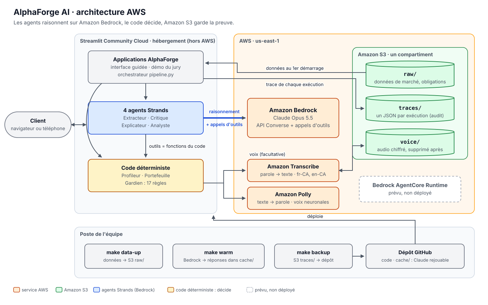

# AlphaForge AI : architecture AWS

**En une phrase :** quatre agents Strands raisonnent avec **Claude Opus 5.5 sur Amazon Bedrock**, le code
déterministe décide des limites et des nombres, et **Amazon S3** garde la preuve de chaque exécution; **Amazon
Transcribe** et **Amazon Polly** ajoutent la voix (facultative). Tout est dans la région **us-east-1**.

*Image : [SVG](AWS_ARCHITECTURE.svg) · [PNG](AWS_ARCHITECTURE.png) (générées par `scripts/build_aws_diagram.py`) ·
architecture des agents : [`architecture.md`](architecture.md) · English: [`AWS_ARCHITECTURE.en.md`](AWS_ARCHITECTURE.en.md)*

## Ce que fait chaque service

| Service | Rôle dans AlphaForge | Appel | Données | Quand |
|---|---|---|---|---|
| **Amazon Bedrock** | fait raisonner les 4 agents : l'**Extracteur** lit une description libre, le **Critique** enquête avant d'objecter (≤ 6 appels d'outils), l'**Explicateur** rédige la réponse, l'**Analyste** répond aux questions de suivi | `bedrock-runtime` Converse (via le `BedrockModel` du SDK Strands), modèle `global.anthropic.claude-opus-5-5` | entrée : faits préparés par le code (profil, limites, stratégies); sortie : texte et appels d'outils, vérifiés par le code | à chaque analyse et chaque question |
| **Strands Agents SDK** (AWS, open source) | boucle d'agent : donne à chaque agent ses outils déterministes (corrélations, crise de 2022, part de risque, « et si »…), plafonne et trace les appels | bibliothèque Python dans l'application | outils JSON en entrée et en sortie | à chaque appel d'agent |
| **Amazon S3** · `traces/` | **preuve d'audit** : la trace complète de chaque exécution (profil, limites, stratégies, verdicts du Gardien, appels d'outils, texte final), jamais le raisonnement brut du modèle | `PutObject` | un JSON par exécution, des deux applications et de la ligne de commande | à la fin de chaque analyse |
| **Amazon S3** · `raw/` | **données** de l'application hébergée : prix des 31 actifs, change, taux, avoirs des FNB, catalogue d'obligations sourcé | `GetObject` (lecture), `PutObject` depuis `make data-up` | CSV publics documentés (`data/README.md`); les données ne vont jamais dans git | au premier démarrage de l'application |
| **Amazon S3** · `voice/` | **tampon de la voix** : l'audio dicté, puis sa transcription | `PutObject`, `GetObject`, `DeleteObject` | audio WAV chiffré (AES-256), **supprimé** dès la transcription lue | seulement si la voix est activée |
| **Amazon Transcribe** | dicter sa situation au lieu de la taper, en français ou en anglais du Canada | `StartTranscriptionJob`, `GetTranscriptionJob` | lit `voice/…/input.wav`, écrit `voice/…/transcript.json` | seulement si `AF_VOICE_ENABLED=1` |
| **Amazon Polly** | lire la réponse à voix haute | `SynthesizeSpeech`, moteur neuronal (Gabrielle fr-CA, Joanna en) | texte de la réponse déjà vérifié par le Gardien | à la demande du client |
| **AWS STS** | vérifier les identifiants avant une démonstration | `GetCallerIdentity` (`make bedrock-check`) | aucune | avant la démonstration |
| **Bedrock AgentCore Runtime** | héberger le pipeline comme agent géré | — | — | **prévu, non déployé** : l'orchestration reste dans `pipeline.py` |

## Le parcours d'une analyse

1. Le client répond aux questions guidées, écrit sa situation ou la **dicte** (Amazon Transcribe, par `voice/`).
2. L'**Extracteur** (Bedrock) transforme une description libre en profil; le code garde un nombre seulement s'il
   figure dans le texte du client.
3. Le **code** calcule les limites, construit jusqu'à 3 stratégies et les soumet au **Gardien** : aucun appel à AWS,
   aucun nombre décidé par le modèle.
4. Le **Critique** (Bedrock + outils Strands) vérifie les stratégies; une correction relance tout le calcul.
5. L'**Explicateur** (Bedrock) écrit la réponse avec des repères que le code remplit; le Gardien vérifie le texte.
6. La trace complète part dans **S3 `traces/`**. Le client peut écouter la réponse (Amazon Polly) ou poser une
   question à l'**Analyste** (Bedrock), qui relance tout le pipeline.

## Sécurité et données

- **Aucun identifiant dans le dépôt :** les clés AWS vivent dans les secrets de Streamlit Community Cloud ou dans le
  profil AWS local; `.env` n'est jamais versionné, et un garde-fou bloque leur lecture et leur publication.
- **Profils fictifs seulement :** aucune donnée personnelle réelle; simulation, aucune transaction.
- **Moindre conservation :** l'audio est chiffré au repos et supprimé dès la transcription lue; les traces ne
  contiennent jamais le raisonnement brut du modèle.
- **Données publiques documentées :** source, date, traitement et conditions de chaque fichier dans `data/README.md`.

## Résilience : sans AWS, l'application répond encore

| Si… | Alors |
|---|---|
| Bedrock ne répond pas | l'agent bascule vers sa version déterministe (gabarit vérifié, Critique à règles), et la trace le dit |
| S3 est inaccessible | la trace est écrite localement (`outputs/traces/`); l'application le signale |
| le compte AWS de l'événement ferme (lundi) | les réponses de Claude pour les clients de démonstration sont dans `cache/` (versionné) : l'application les **rejoue** et l'indique à l'écran; `make backup` a déjà copié les traces de S3 dans le dépôt |
| la voix n'est pas configurée | le client tape; rien d'autre ne change |

## Pourquoi cette architecture

- **Bedrock pour juger, le code pour décider.** Un agent choisit quoi vérifier et comment l'expliquer; il ne fixe
  jamais une limite ni un nombre. L'ordre des étapes est fixé par `pipeline.py`, pour que le Gardien ne puisse pas
  être contourné (`notes/decisions.md` #14).
- **S3 comme registre d'audit.** Chaque recommandation simulée peut être rejouée et expliquée après coup, comme le
  dossier qu'un conseiller doit conserver.
- **AgentCore reporté, assumé.** Héberger le pipeline comme agent géré était prévu; nous avons privilégié un pipeline
  vérifiable et testé (16/16 profils de test, 400+ tests hors ligne) plutôt qu'un déploiement de dernière minute.
