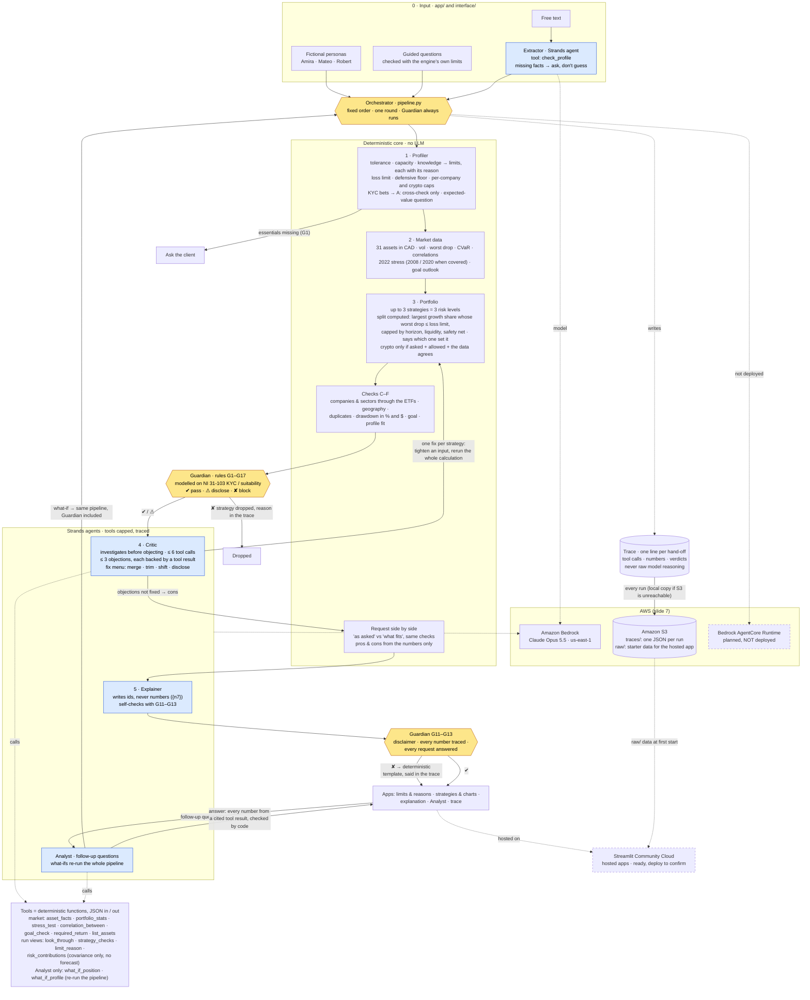

# Architecture: what runs today (updated Sun Nov 15, evening; decisions #14, #30, #40)

**Strands agents for the steps that decide, a fixed pipeline for the orchestration, models on Amazon Bedrock, every
run's trace kept on Amazon S3.** The pipeline runs locally (two Streamlit apps and a CLI), and the apps are ready for
Streamlit Community Cloud, reading the starter data from S3 at first start (`src/dh/bootstrap.py`). Bedrock AgentCore Runtime
was planned "if working by Sunday midday" (#14) and is **not deployed**. "Agents investigate and argue, code enforces."
Dashed = not built / not deployed. Keep this in sync with what actually runs: the jury compares it to the demo.

Yellow = where code decides (orchestrator, Guardian). Blue = Strands agents (they decide which tools to call, never a
limit or a number).

## Layers at a glance

| Layer | Question it answers | Built with |
|---|---|---|
| Orchestration | In what order do the steps run, what happens on a ✘? | `src/dh/agents/pipeline.py`: fixed order, one Critic round, the Guardian can't be skipped. A ✘ on a strategy drops it (reason in the trace); a ✘ on the text swaps in the template |
| Agents that decide | Which tools to call, and when they're done | **Strands Agents** on Bedrock: Extractor, Critic, Explainer, Analyst. Tool calls capped and traced; demo answers cached and committed (`cache/`) so the demo replays without AWS |
| Deterministic steps | The numbers and the rules | Plain Python: Profiler, market data, Portfolio, checks C–F, request side by side, Guardian. The agents call them as tools |
| Model | The LLM | **Amazon Bedrock**: `global.anthropic.claude-opus-5-5` (Claude Opus 5.5), us-east-1, text and tool use verified 2026-11-14 (`make bedrock-check`). Critic/Analyst model switchable with `BEDROCK_CRITIC_MODEL_ID` |
| Hosting | Where the pipeline runs | **Locally**: demo app (`make app`), guided interface (`make ui`), CLI (`python -m dh explain`). **Streamlit Community Cloud**: ready (`requirements.txt`, README steps), data from `s3://$S3_BUCKET/raw/` (`make data-up`) at first start; deployment to confirm. Bedrock AgentCore Runtime: **not deployed** |
| Traces and data | Where runs and data are kept | **Amazon S3**: `raw/` holds the starter CSVs for the hosted app (`make data-up`); `traces/` every run from both apps and the CLI (`dh.tracestore`, #25); local copy in `outputs/traces/` if S3 is unreachable; `make backup` pulls them into git before the account closes |

| Component | LLM? | Output |
|---|---|---|
| Extractor | yes (Strands, tool `check_profile`) | `profile` fields from free text; follow-up questions for what's missing; code checks every field (#29) |
| Profiler | no | `limits`: risk level, loss limit, floors, per-company and crypto caps, each with a reason; KYC cross-check `limits["kyc"]` (#40) |
| Market data | no | per-asset facts, `strategy_stats`, stress windows, goal outlook (Joud) |
| Portfolio | no | up to 3 strategies = 3 risk levels (#32), split computed and says what set it (#17, #22, #33) |
| Checks C–F | no | one shape per check: value, limit, status, reason, source (#20) |
| Guardian | no | ✔ / ⚠ / ✘ per rule G1–G17 on each strategy; G11–G13 on the text |
| Critic | yes (Strands, 11 tools) | ≤ 3 objections backed by tool results; one fix per strategy that reruns the whole calculation, re-checked by the Guardian, original kept if it fails (#30) |
| Request side by side | no | the client's request "as asked" vs "what fits", same checks; pros and cons from the numbers (#28) |
| Explainer | yes (Strands, tool `check_text`) | client text with number ids filled by code (strict G12, #27); template if a check fails (#23) |
| Analyst | yes (Strands, tools) | answers to follow-ups; what-ifs re-run the pipeline, Guardian included; every number from a cited tool result (#35) |

**Not in the demo:** the Markowitz optimiser (branch `optimisation-markowitz`, Joud) was tested and set aside (#37):
with historical average returns its weights move with the window and lost to equal weights out of sample. What
doesn't depend on average returns is used: risk contributions (Critic tool) and the KYC bets (Profiler cross-check), #40.

Why not let an agent orchestrate: a supervisor agent choosing the next step looks more agentic, but nothing would
guarantee the Guardian runs every time, and the 16 test scenarios would stop being reliable (`notes/decisions.md` #14).
