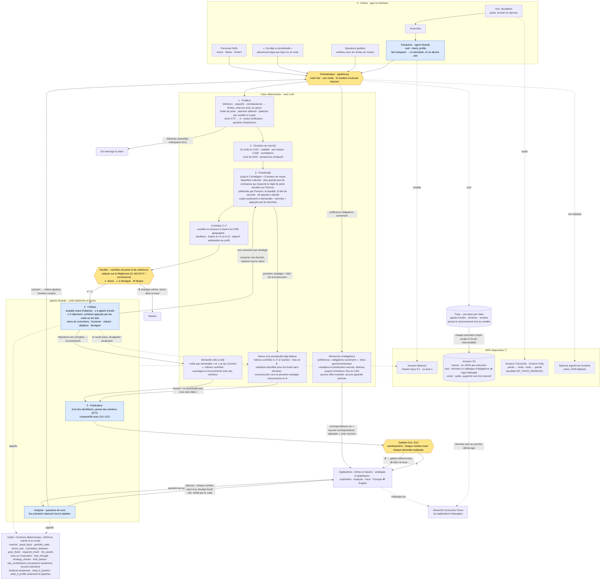

# Architecture : ce qui fonctionne aujourd'hui (15 novembre; décisions #14, #30, #40, #42, #46, #49)

**Des agents Strands pour les étapes qui décident, un pipeline fixe pour l'orchestration, des modèles sur Amazon
Bedrock, la trace de chaque exécution conservée dans Amazon S3.** Les deux applications Streamlit fonctionnent en
local et sur Streamlit Community Cloud, qui lit les données dans S3 au premier démarrage; une ligne de commande exécute
le même pipeline. Bedrock AgentCore Runtime était prévu et n'est **pas déployé**. « Les agents enquêtent et
argumentent, le code fait respecter. » Pointillés = non construit, non déployé ou facultatif.
Image : [`architecture.png`](architecture.png) · *English: [`architecture.en.md`](architecture.en.md)*

Jaune = là où le code décide (orchestrateur, Gardien). Bleu = agents Strands (ils décident quels outils appeler,
jamais une limite ni un nombre).

## Les couches en bref

| Couche | Question à laquelle elle répond | Construite avec |
|---|---|---|
| Orchestration | Dans quel ordre s'exécutent les étapes, que se passe-t-il sur un ✘ ? | `src/dh/agents/pipeline.py` : ordre fixe, une ronde du Critique, le Gardien ne peut pas être contourné. Un ✘ sur une stratégie la retire (raison dans la trace); un ✘ sur le texte le remplace par le gabarit |
| Agents qui décident | Quels outils appeler, et quand s'arrêter | **Strands Agents** sur Bedrock : Extracteur, Critique, Explicateur, Analyste. Appels plafonnés et tracés; réponses de démonstration enregistrées et versionnées (`cache/`) pour rejouer sans AWS |
| Étapes déterministes | Les nombres et les règles | Python ordinaire : Profileur, données de marché, Portefeuille, contrôles C–F, demande côte à côte, Gardien. Les agents les appellent comme outils |
| Modèle | Le LLM | **Amazon Bedrock** : `global.anthropic.claude-opus-5-5` (Claude Opus 5.5), us-east-1, texte et outils vérifiés le 2026-11-14 (`make bedrock-check`) |
| Hébergement | Où s'exécute le pipeline | **Streamlit Community Cloud** (applications hébergées) et **en local** (`make app`, `make ui`, ligne de commande). Données tirées de `s3://$S3_BUCKET/raw/` au premier démarrage. Bedrock AgentCore Runtime : **non déployé** |
| Traces et données | Où sont conservées les exécutions et les données | **Amazon S3** : `traces/` chaque exécution des deux applications et de la ligne de commande (copie locale si S3 est inaccessible); `raw/` les données de l'application hébergée; `voice/` l'audio à transcrire, supprimé ensuite |
| Voix (facultative) | Parler au lieu de taper | **Amazon Transcribe** (parole → texte, français ou anglais du Canada) et **Amazon Polly** (réponse lue à voix haute), dans l'interface guidée, désactivée sauf si `AF_VOICE_ENABLED=1` |
| Langue | Français ou anglais | Bouton Français ⇄ English dans les deux applications, français par défaut (`AF_LANG`) : interface, textes du moteur (traduits à l'affichage, nombres intacts) et textes de Claude (rédigés directement en français), #49 |

| Composant | LLM ? | Résultat |
|---|---|---|
| Extracteur | oui (Strands, outil `check_profile`) | champs du `profile` à partir du texte libre; questions de suivi pour ce qui manque; le code vérifie chaque champ (#29) |
| Profileur | non | `limits` : niveau de risque, limite de perte, planchers, plafonds par société et crypto, chacun avec sa raison; contre-vérification KYC (#40) |
| Données de marché | non | faits par actif, `strategy_stats`, périodes de crise, perspective d'objectif (Joud) |
| Portefeuille | non | jusqu'à 3 stratégies = 3 niveaux de risque (#32); plafond de croissance = plus grande part dont la probabilité simulée d'une baisse plus forte que la limite de perte sur l'horizon est ≤ 10 % (#46), plafonnée par la règle d'horizon, les retraits et le filet de sécurité; dit ce qui a décidé (#33) |
| Contrôles C–F | non | même forme pour chaque contrôle : valeur, limite, statut, raison, source (#20) |
| Gardien | non | ✔ / ⚠ / ✘ par règle sur chaque stratégie (17 règles : G1–G16 et G18; G7 = probabilité simulée d'une baisse plus forte que la limite de perte sur l'horizon ≤ 10 %, G18 = chaque nombre décrit les pondérations finales, #46); G11–G13 sur le texte |
| Critique | oui (Strands, 11 outils) | ≤ 3 objections, chaque nombre appuyé par un résultat d'outil cité ou par les faits reçus (#45); une correction par stratégie qui relance tout le calcul, revérifiée par le Gardien, l'original conservé en cas d'échec (#30) |
| Recherche d'obligations | non | pour une préférence « obligations seulement » : titres gouvernementaux canadiens et américains sourcés, détenus jusqu'à l'échéance (taux, échéance, flux en CAD); références publiques, pas des offres de courtiers; dit quand rien ne correspond |
| Demande côte à côte | non | la demande du client « telle que demandée » et « ce qui convient », mêmes contrôles; avantages et inconvénients tirés des nombres (#28) |
| Explicateur | oui (Strands, outil `check_text`) | texte au client avec des identifiants de nombres remplis par le code (G12 strict, #27); gabarit si un contrôle échoue (#23) |
| Revue d'un portefeuille déjà détenu | non (+ Critique, Explicateur, Analyste) | ce que le client détient, avec les mêmes contrôles C–F et le Gardien, les frais en $, des substituts identifiés et les mouvements en $ vers la première stratégie (#42, #44) |
| Analyste | oui (Strands, outils) | réponses aux questions de suivi; les scénarios relancent le pipeline, Gardien compris; chaque nombre vient d'un résultat d'outil cité (#35) |

**Hors de la démonstration :** l'optimiseur de Markowitz (branche `optimisation-markowitz`, Joud) a été testé et
écarté (#37) : avec des rendements moyens historiques, ses pondérations changeaient avec la période et ont perdu contre
l'équipondération hors échantillon. Ce qui ne dépend pas des rendements moyens est utilisé : les contributions au
risque (outil du Critique) et les choix KYC (contre-vérification du Profileur), #40.

Pourquoi ne pas laisser un agent orchestrer : un agent superviseur qui choisit l'étape suivante paraît plus agentique,
mais rien ne garantirait que le Gardien s'exécute à chaque fois, et les 16 scénarios de test ne seraient plus fiables
(`notes/decisions.md` #14).
