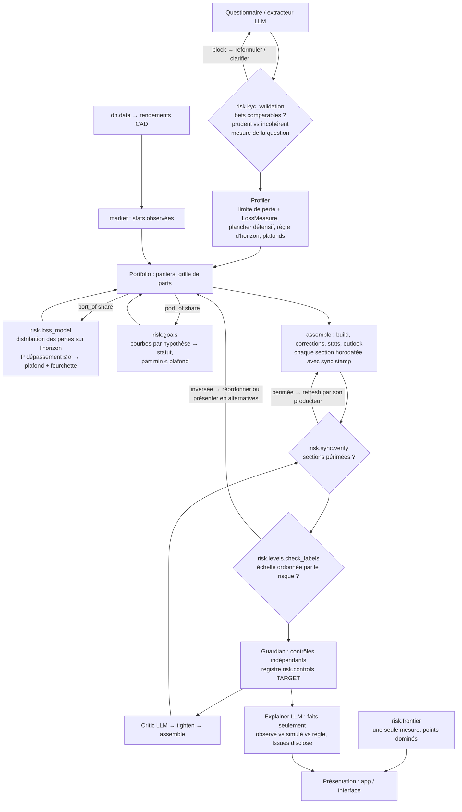

# Architecture de résolution des anomalies quantitatives

Branche `claude/nice-volta-4dwcp4`. Suite de l'audit théorique (anomalies A1-A16).
- **Phase 1** (commit 2ac3c2f) : squelette `src/dh/risk/`, tests, ce document.
- **Phase 2** (commit c019584, résultats 01e9671) : décisions R0-R10 approuvées et appliquées. Le paquet est branché
  sur le Portfolio, les contrôles, le Guardian, le Critic, les demandes, le KYC et les graphiques. Décision #42.
  **Non fusionnée** : revue de Will requise, et hors gel Devpost.

Légende des preuves : [T] test reproductible dans `tests/test_risk_*.py`, [R] `results.csv` (données réelles),
[C] lecture du code.

## Phase 2 — ce qui a changé et ce qui est vérifié

| Anomalie | Correction | Vérification |
|---|---|---|
| A1 plafond | `portfolio.split_search` → `loss_model.equity_ceiling` (P(MDD sur l'horizon > limite) ≤ 10 %, bootstrap, prime centrale 3 %, nombres aléatoires communs, arrêt au premier dépassement) ; fourchette sur sous-fenêtres de 3 ans ; règle d'horizon conservée | `test_portfolio::test_ceiling_respects_loss_limit_and_is_the_largest`, `test_risk_loss_model` (dépassement réel 15-24 % au lieu de 39-71 % pour α = 10 %) [T] |
| A2 objectifs | `portfolio.goal_assessment` → `goals.classify` (5 statuts) ; message sans « plus de 100 % » ; `goal_outlook` ajoute la vue centrale et les dollars d'aujourd'hui ; contrôle E sur la vue centrale | `test_risk_goals`, `test_checks::test_e_goal` [T] |
| A3 niveaux | même panier défensif à tous les niveaux ; niveau inversé retiré, niveau mixte signalé | `test_portfolio::test_levels_are_ordered_by_measured_risk` [T], `test_risk_levels::test_results_csv_latest_ladders_are_not_inverted` [R] |
| A4 KYC | grille de A commune (0 à 4,8) ; cohérence par rang ; réponses prudentes « censurées » et non incohérentes | `test_risk_kyc` (anciens xfail devenus des tests normaux) [T] |
| A5 frontière | graphique entier en moyenne arithmétique ; échec de l'optimiseur sans exception | `test_risk_frontier`, `test_market` [T] |
| A6 synchronisation | toutes les sections calculées sur les poids finaux et horodatées ; G18 | `test_risk_sync::test_outlook_describes_final_weights` (ancien xfail) [T] |
| A7 contrôles | G7 = D2 = règle de perte simulée sur les poids finaux ; G17 fusionné ; D1 informatif ; Critic et demandes sur la même règle | `test_checks`, `test_risk_controls::test_guardian_matches_the_registry` [T] |
| A8 question | « plus grande baisse depuis un sommet, à tout moment » (questionnaire, interface, extracteur) | `test_risk_kyc::test_loss_question_matches_the_engine_measure` [T] |
| A10 MDD | `metrics.max_drawdown` compte une baisse dès le jour 1 | `test_risk_math` (anciens xfail) [T] |

Suite complète : 280 tests passés, 2 sautés (données réelles présentes). Les 5 tests xfail stricts de la phase 1 sont
tous passés au vert et ont été retirés consciemment, en citant la correction.

Effet sur les personas (données réelles reconstruites avec le script officiel, `results.csv`) :

| Persona | Avant | Après |
|---|---|---|
| Amira | 95 / 85 / 75 % de croissance ; pire baisse du niveau 1 −32,9 % | 40 / 35 / 25 % ; −14,8 %. Sa limite de 40 % sur 15 ans : au-delà, plus de 10 % des trajectoires simulées la dépassent |
| Mateo | 60 / 50 / 40 % ; « le plus prudent » plus risqué que « plus prudent » | 55 / 45 % ; le troisième niveau, pas plus sûr, est retiré |
| Robert | 15 / 5 % ; « plus prudent » à −9,5 % / 5,7 % (inversé) | 15 / 5 % ; « plus prudent » à −7,7 % / 1,8 % |

Le refus de 25 % de TSLA pour Robert ne change pas (plafond par société, #24).

À faire hors de cette branche (non modifié ici, car déjà soumis ou propriété d'une autre voie) :
- livrables (one-pager, document technique, vidéo) : ils citent les anciens chiffres et « 17 règles ». Le nombre de
  contrôles indépendants est maintenant `controls.count_independent(TARGET)` ;
- caches de démo (Critic, Explainer, Analyst) : les faits ont changé, donc ils seront recalculés ou passeront au gabarit hors ligne ;
- coût : Amira ~10 s au lieu de ~4,5 s.

---

## Phase 1 — analyse et conception (inchangée ci-dessous)

---

## 1. Causes profondes (vérifiées dans le code)

| # | Fichiers / fonctions | Chemin des données | Hypothèse utilisée | Où le problème apparaît | Autres modules touchés | Nature |
|---|---|---|---|---|---|---|
| **A1** Plafond trop optimiste | `portfolio.split_search`, `what_set_the_split`, `rules.RISK_LEVELS.max_drawdown`, `guardian` G7 | profil → `profiler.loss_limit` = min(tolérance, seuil de capacité) → pour chaque part de 0 à 100 % : `build` → `market.strategy_stats` → `metrics.max_drawdown` (2021-26) → plus grande part ≤ limite | le MDD de la fenêtre représente les pertes futures, quel que soit l'horizon | à la sélection : on choisit au bord d'une contrainte mesurée sur **une** réalisation (malédiction du gagnant), puis le même chiffre sert de preuve (G7). Les seuils de capacité (#13) ont aussi été calibrés sur 2021-26 | `requests.py` (côte à côte), `crypto_decision` (compare deux plafonds), D1/D2/G17, Explainer, Analyst | **méthode + architecture** (circularité) |
| **A2** Plancher d'objectif | `split_search` (boucle du plancher), `market.goal_outlook` (risk_only), `checks.e_goal`, `interface/core/questions.py:101` | objectif saisi → `goal_outlook(..., risk_only)` par part → plus petite part avec P ≥ 50 % → sinon « plus de 100 % » | dans la vue risk-only, le rendement espéré des actions = celui du cash | dans la recherche : sans prime, plus d'actions = même moyenne, plus de variance → médiane en baisse [T] ; le seuil de 50 % n'est atteignable qu'à 0 % d'actions | message de conflit, contrôle E, Explainer, Analyst (« what-if ») | **méthode** (modèle incompatible avec la question posée) |
| **A3** Niveaux non ordonnés | `portfolio.levels` (`f = order[i]`), `level_limits`, `STRATEGY_DEFS` (paniers défensifs différents) | niveau 1 = saveur préférée ; niveau k = **autre saveur** et part d'actions −10·(k−1) points | part d'actions = mesure du risque | deux variables changent en même temps (panier et part) ; l'étiquette ne dépend que de la part. Robert : « plus prudent » −9,5 % / 5,7 % contre −8,6 % / 3,9 % [R] | `requests.pros_cons`, Explainer (« plus prudent »), interface | **architecture + interprétation** |
| **A4** KYC incomparable | `kyc.BETS`, `kyc.score`, `profiler.kyc_check` | réponses → A par pari → médiane ; écart > 2 → signalé, A = max | A comparable d'un pari à l'autre | les grilles d'options ne couvrent pas la même plage de A (max 8,9 / 4,8 / 9,6) [T] : une borne (censure) est lue comme une incohérence | `profiler.kyc_check` (signal « à clarifier »), trace | **calcul (conception de la grille) + interprétation** |
| **A5** Frontière | `market_charts.risk_return_data`, `qt.efficient_frontier` | μ arithmétique → optimiseur → points remesurés en CAGR | μ arithmétique ≈ CAGR | au tracé : deux mesures sur le même axe → la courbe revient en arrière, points dominés [T]. **Nouveau** : l'optimiseur SLSQP peut échouer (limite d'itérations) → exception non gérée dans le graphique [T] | graphique de l'app seulement | **méthode + technique** |
| **A6** Résultats périmés | `portfolio.assemble`, `revise` (Critic) | `split_search` → outlook(w) → `fix_diversification` → w2 → stats(w2) mais outlook(w) | (aucune : oubli) | dans `assemble` : rien ne lie une section aux poids qu'elle décrit [T] | contrôle E, `prob_loss` affiché, Explainer, Critic (`revise` passe par `assemble`) | **architecture** (pas de versionnage) |
| **A7** Contrôles redondants | `checks.d1/d2/d3`, `guardian` G7/G17, `pipeline` (un ✘ C-F supprime la stratégie) | MDD fenêtre ≤ limite : construction, D1, D2, G7, G17 | « plus de contrôles = plus sûr » | même inégalité 5 fois ; G7 ne peut échouer pour une stratégie construite par le Portfolio (sauf « même 0 % dépasse ») [T] | livrables (« 17 règles »), taux de réussite des scénarios | **architecture** |
| **A8** Question de perte | `questions.py:114`, `kyc.QUESTIONS`, `profiler.derive_limits` | « plus grande baisse **en un an** » → `max_loss_pct` → limite comparée au MDD sur toute la fenêtre | les deux mesures sont équivalentes | à la comparaison : WORST_12M ≠ MDD_WINDOW (MDD ≥ pire 12 mois, et il croît avec la durée) | toutes les règles A1/A7 | **interprétation** |
| **A10** MDD jour 1 | `metrics.max_drawdown` | pic initial = 1 + r₀ | — | formule [T] | toute mesure de perte | **calcul** |

Constats nouveaux de cette phase :
1. **Le remède A1 ne suffit pas seul** [T]. Sur 15 historiques synthétiques de 5 ans (paramètres connus), le bootstrap sur l'horizon avec α = 10 % ramène le dépassement réel de 39 / 64 / 71 % à **15 / 24 / 20 %** (limite 15 % à 4 ans et 10 ans ; limite 25 % à 15 ans). C'est nettement mieux, mais encore au-dessus de α, et la part choisie reste instable (0 % à 55 %). Cinq ans de données ne suffisent pas à estimer une queue : la règle d'horizon (#22) doit rester un garde-fou, et l'incertitude doit être affichée, pas cachée.
2. A1 et A8 ont la même racine : aucune donnée ne dit **quelle mesure de perte** elle porte. D'où `contracts.LossMeasure`.
3. A3, A6 et A7 ont la même racine architecturale : le Portfolio calcule, se vérifie et s'étiquette lui-même, sans contrôle de cohérence extérieur. D'où un module de cohérence séparé de la construction (`sync`, `levels.check_labels`, `controls`).

---

## 2. Architecture cible

Principe : **calcul → validation → présentation**, dans cet ordre. Chaque module répond à une seule question et ne recalcule jamais le résultat d'un autre.

| Couche | Composant | Une seule question |
|---|---|---|
| Vocabulaire | `risk.contracts` | quelle mesure, quelle hypothèse, quel type d'erreur ? |
| Profil | `risk.kyc_validation` (D) | les réponses sont-elles comparables, cohérentes, et mesurent-elles ce que le moteur utilise ? |
| Calcul | `risk.loss_model` (A) | quelle part de croissance garde la probabilité de dépasser la limite sous α, avec quelle incertitude ? |
| Calcul | `risk.goals` (B) | l'objectif est-il atteignable, sous quelle hypothèse, avec quelle part minimale ≤ plafond ? |
| Calcul | `risk.frontier` (E) | quelle frontière, dans quelle mesure ? |
| Cohérence | `risk.sync` (F) | chaque section décrit-elle les poids et données finaux ? |
| Cohérence | `risk.levels` (C) | l'échelle présentée est-elle ordonnée par le risque ? |
| Gouvernance | `risk.controls` (G) | chaque contrôle est-il unique et indépendant de la construction ? |

Aucun nouvel agent. Les agents existants gardent leur rôle : le Profiler, le Portfolio et le Guardian **appelleront** ces fonctions en phase 2, et les agents LLM reçoivent les faits produits.

**Règle de dépendance (testée)** : `dh.risk` n'importe que `dh.metrics`, `dh.quant_toolkit`, `dh.data`, `dh.kyc` et `dh.agents.rules`. Le Portfolio, le Guardian et `checks` importeront `dh.risk`, jamais l'inverse : aucun cycle possible.

Données partagées : rendements via `dh.data` (inchangé), statistiques via `dh.metrics` (inchangé), et en plus les tampons (`sync.STAMP`) et les `Issue` (`contracts`).

Gestion des erreurs : les entrées invalides lèvent `ValueError` (erreur technique, avant tout calcul). Les problèmes de méthode ou d'interprétation sont renvoyés comme `Issue(severity=block|disclose|info, kind=technical|method|interpretation)` et non levés, pour que la trace et l'Explainer puissent les citer. Un `block` empêche d'afficher le résultat comme valide.

Déclencheurs de recalcul (`sync`) : poids modifiés (arrondi, correction de diversification, Critic, niveau), données modifiées (fenêtre, substituts), hypothèse modifiée (objectifs), limites modifiées (contrôles seulement).

---

## 3. Schéma : des réponses KYC aux portefeuilles présentés



---

## 4. Arborescence

Nouveaux fichiers (créés dans cette phase) :
```
src/dh/risk/__init__.py          carte du paquet + règle de dépendance
src/dh/risk/contracts.py         ReturnMeasure, LossMeasure, Evidence, Assumption, Issue
src/dh/risk/loss_model.py   (A)  LossDistribution, HistoricalWindow, StationaryBootstrapLoss, equity_ceiling,
                                 window_sensitivity, walk_forward, drawdowns
src/dh/risk/goals.py        (B)  ZERO_PREMIUM, FAVOURABLE, GoalStatus, recentre, probability_curve, min_share,
                                 classify, explanation_facts
src/dh/risk/levels.py       (C)  DIMENSIONS, PRIMARY, RiskVector, risk_vector, compare, check_labels, order
src/dh/risk/kyc_validation.py (D) comparability, rank, consistency, comparable, normalise_loss_limit (en attente R7)
src/dh/risk/frontier.py     (E)  measure_of, frontier, dominated, check, drag_gap
src/dh/risk/sync.py         (F)  fingerprint_weights, fingerprint_data, stamp, verify, refresh
src/dh/risk/controls.py     (G)  Kind, ControlSpec, CURRENT, TARGET, audit, count_independent
tests/risk_markets.py            marchés synthétiques à paramètres connus + 7 régimes de stress
tests/test_risk_{math,loss_model,goals,levels,kyc,frontier,sync,controls}.py
```

Fichiers à adapter en **phase 2** (non touchés aujourd'hui) :

| Fichier | Changement prévu | Propriétaire |
|---|---|---|
| `src/dh/agents/portfolio.py` | `split_search` → `loss_model.equity_ceiling` + `goals.classify` ; `assemble` → stamps + `sync.refresh` ; `levels` → `levels.check_labels` | Will |
| `src/dh/agents/checks.py`, `guardian.py` | registre TARGET (G7 devient « disclose », G7b, D3 en distribution ; D1/D2/G17 fusionnés) | Will |
| `src/dh/agents/profiler.py` | limite de perte avec sa `LossMeasure` ; `kyc_check` via `kyc_validation.consistency` | Will |
| `src/dh/kyc.py`, `interface/core/questions.py` | grilles de paris recalibrées (R6) ; libellé de la question de perte (R7) | Joud / Will |
| `src/dh/metrics.py` | A10 : pic initial = 1 (fichier partagé, à annoncer) | partagé |
| `src/dh/agents/market_charts.py` | frontière via `risk.frontier` (une mesure) | Joud |
| `src/dh/agents/market.py` | `goal_outlook` renvoie aussi les courbes par hypothèse (ou délègue à `goals`) | Joud |
| `src/dh/agents/explainer.py`, `analyst.py` | nouveaux faits : statut d'objectif, observé/simulé, Issues `disclose` | Will |
| `notes/contract.md` | champs `split_range` (probabilité, fourchette), `goal.status`, stamps | partagé |

---

## 5. Interfaces

Les signatures complètes et documentées sont dans les fichiers ci-dessus. Résumé des points d'entrée que le Portfolio appellera :

```python
loss_model.equity_ceiling(port_of: Callable[[float], pd.Series], grid, limit, horizon_years, alpha, model,
                          max_share=1.0) -> CeilingDecision(share|None, table[{share, exceedance, p5, observed}], issues)
loss_model.window_sensitivity(rets_window, windows, **ceiling_kw) -> {by_window, range, issues}
loss_model.walk_forward(port_of_split, split_date, **ceiling_kw) -> {in_sample, out_of_sample_drawdown, breached}
goals.probability_curve(port_of, grid, assumption, cash_daily, capital, horizon_years, target, ...) -> [{share, prob, p50}]
goals.classify(curves, assumptions, ceiling, p_min, p_low) -> GoalAssessment(status, min_share ≤ ceiling | None)
levels.risk_vector(strategy, limits, capital) -> RiskVector     # lit, ne recalcule pas
levels.check_labels([(label, RiskVector)], dims=PRIMARY) -> [Issue]
kyc_validation.consistency(answers, max_rank_gap) -> Consistency(status, ranks, a_bounds, issues)
frontier.frontier(rets, measure) -> Frontier(measure, points, method, issues)
sync.stamp(section, weights, rets, producer) / sync.verify(strategy, rets) / sync.refresh(strategy, producers, rets)
controls.audit(registry) -> [Issue]
```

Points provisoires (volontairement non implémentés ou sans valeur par défaut) : `alpha` (R1), fenêtres de sensibilité (R2), prime « centrale » (R3), `p_min`/`p_low` (R4), dimensions principales (R5), écart de rang KYC (R6), `normalise_loss_limit` (R7), proxy de risque de taux (durées des émetteurs à sourcer).

---

## 6. Méthodes mathématiques et statistiques

| Module | Méthode | Hypothèses | Limites à afficher |
|---|---|---|---|
| A | Bootstrap stationnaire (Politis & Romano, 1994) des rendements quotidiens du portefeuille sur H années → distribution du MDD de l'horizon ; plafond = max{s : P(MDD_H(s) > L) ≤ α} ; fourchette par sous-fenêtres ; un test hors échantillon (walk-forward) | dépendance courte (bloc ≈ n^⅓) ; le passé contient les états futurs possibles | aucune crise nouvelle ; 5 ans ≈ un marché baissier ; erreur d'estimation mesurée : 15-24 % de dépassement réel pour α = 10 % [T] |
| B | Même moteur ; moyenne recentrée par hypothèse : cash + s·prime (la prime ne s'applique qu'à la part de croissance) ; nombres aléatoires communs entre les parts ; recherche de la part minimale seulement si prime > 0 | prime constante ; frais et impôts ignorés | la prime « centrale » est un choix, pas une estimation ; résultats nominaux (inflation : R9) |
| C | Vecteur de risque (9 dimensions définies séparément) ; ordre de Pareto avec tolérance ; couches non dominées | les mesures sont comparables entre stratégies (même fenêtre, même horizon) | un ordre partiel est normal : les stratégies non classables sont présentées comme alternatives |
| D | Rang dans la grille d'options (0 = audacieux, 1 = prudent) ; intervalle de A par option ; censure aux bornes ; mesure déclarée pour chaque question | préférences moyenne-variance | les paris avec perte mêlent aversion aux pertes et A |
| E | Markowitz exact en moyenne arithmétique, ou enveloppe de Pareto en CAGR parmi les candidats ; contrôle de dominance et de retour en arrière ; écart à μ − σ²/2 | μ et Σ de la fenêtre | rétrospectif et biaisé par la survivance (#1, inchangé) |
| F | Empreintes SHA-256 des poids (arrondis à 1e-6) et des données (colonnes, dates, sommes) | — | l'empreinte des données est rapide, pas cryptographiquement exhaustive |
| G | Registre déclaratif ; doublon = mêmes (entrées, mesure, méthode, critère) ; circulaire = contrôle indépendant identique à une contrainte de construction | — | D1 est *impliqué* par D2 (critère différent) : signalé dans ce document, pas par `audit` |

---

## 7. Matrice anomalie → module

| Anomalie | A loss_model | B goals | C levels | D kyc_validation | E frontier | F sync | G controls | contracts |
|---|---|---|---|---|---|---|---|---|
| A1 plafond optimiste | **résout** | | | | | | circularité | LossMeasure, Evidence |
| A2 plancher d'objectif | | **résout** | | | | | | Assumption |
| A3 niveaux | | | **résout** | | | | C-ladder | |
| A4 KYC | | | | **résout** | | | D-kyc | |
| A5 frontière (+ échec SLSQP) | | | | | **résout** | | E-frontier | ReturnMeasure |
| A6 résultats périmés | | | | | | **résout** | F-sync | |
| A7 contrôles redondants | (nouvelle construction) | | | | | | **résout** | |
| A8 question de perte | (mesure de l'horizon) | | | **détecte** (R7 pour résoudre) | | | | LossMeasure |
| A10 MDD jour 1 | `drawdowns` correct | | | | | | | (phase 2 : metrics) |
| A13 inflation | | prévu (R9) | | | | | | |

---

## 8. Plan de tests

Chaque fichier sépare `TestTechnical` (entrées, données manquantes, types, historiques trop courts), `TestMethod` (propriétés statistiques, références connues), `TestInterpretation` (le sens présenté au client) et `TestAnomaly` (reproduction).

Convention anti-« résolu par accident » :
- un comportement **voulu** qui échoue aujourd'hui est marqué `xfail(strict=True)` (5 tests : A10 ×2, A4 ×2, A6). Quand une correction le fait passer, *strict* fait échouer la suite : on retire le marqueur consciemment, en citant la correction ;
- un comportement **actuel** fautif est documenté par un test qui passe aujourd'hui (A2, A3 sur `results.csv`, A5, A7). En phase 2, il sera inversé.

| Catégorie demandée | Où | État |
|---|---|---|
| Formules indépendantes, résultats connus | `test_risk_math` (MDD vs `qt`, CAGR ≈ μ − σ²/2, log = ln(1+CAGR), recentrage, moyenne du bootstrap) | ✔ |
| Stabilité : fenêtres, paramètres, hypothèses, limites, compositions | `test_risk_loss_model` (horizon, limite, part, sous-fenêtres, hors échantillon sur 8 historiques), `test_risk_goals` (hypothèses) | ✔ partiel ; balayage complet des paramètres en phase 2 |
| Scénarios : krach, taux, baisse conjointe, inflation, forte volatilité, choc exceptionnel | `tests/risk_markets.REGIMES`, `test_risk_loss_model::TestScenarios` | ✔ (inflation : sautée, il faut une vue en termes réels, R9) |
| Cohérence : niveaux, probabilités = poids, hypothèses compatibles, pas de points dominés, prudent ≠ incohérent | `test_risk_levels`, `test_risk_sync`, `test_risk_goals`, `test_risk_frontier`, `test_risk_kyc` | ✔ |
| Limites techniques | dans chaque `TestTechnical` (vide, NaN, −100 %, < 20 jours, < 60 jours, α hors bornes, option inconnue, échec de l'optimiseur) | ✔ |
| Architecture | `test_risk_controls` (imports autorisés, `contracts` sans dépendance, registre TARGET propre) | ✔ |

Résultat actuel : 54 passés, 1 sauté, 5 xfail (`tests/test_risk_*.py`, ~7 s). Suite complète : 259 passés ; seul `test_app.py` échoue, faute de streamlit dans mon environnement de test (dépendance, sans lien avec ce changement).

Critères d'acceptation de la phase 2 (au-delà de « le test passe ») :
- **A1** : sur les marchés synthétiques, le dépassement réel moyen est ≤ α + marge approuvée, et la fourchette de part est affichée ; aucun texte ne présente le MDD observé comme une garantie (vérifié par G12 et la relecture d'une trace).
- **A2** : aucun message ne mentionne une part > plafond ; chaque statut a une trace d'exemple.
- **A3** : `check_labels` ne renvoie aucun `C-inverted` pour les trois personas sur les vraies données ; les `C-mixed` sont affichés.
- **A6** : `sync.verify` est vide sur toutes les stratégies de `make scenarios`.
- **A7** : `controls.audit(registre réel)` est vide ; les livrables citent `count_independent`.

---

## 9. Risques de régression

1. **Tous les chiffres changent** (plafonds plus bas avec A1, niveaux réordonnés avec A3) : `results.csv`, one-pager, document technique, cache de démo de l'Explainer, chiffres de G12. Règle 3 de CLAUDE.md : rien dans le pitch sans nouvelle entrée dans results.csv.
2. **Temps de calcul** : bootstrap par part de la grille × saveurs × niveaux × `crypto_decision` (deux plafonds) × révision du Critic. À mesurer : grille plus grossière, recherche par dichotomie (l'exceedance est monotone en s), mise en cache par empreinte (`sync`).
3. **Tests existants** qui figent le comportement actuel : `test_portfolio::test_ceiling_respects_loss_limit_and_is_the_largest` (plafond in-sample), tests du Guardian G7/G17, `test_kyc_check`.
4. **Personas** : Amira pourrait perdre beaucoup d'actions (horizon 15 ans → MDD de l'horizon plus profond) ; le récit « Robert reçoit un non » ne change pas (règle de plafond par société, #24).
5. **Interface** : nouveaux statuts d'objectif et nouveaux messages à traduire ou afficher.
6. **Propriété des voies** : la phase 2 touche surtout des fichiers de Will (agents) ; à coordonner.
7. **Gel Devpost dimanche 23:59** : toute correction après le gel est exclue de la soumission.

---

## 10. Décisions à approuver

| # | Décision | Options | Ma recommandation |
|---|---|---|---|
| R0 | Calendrier | (a) rien avant le gel, présenter comme amélioration ; (b) seulement A6 + A10 + A3 avant le gel ; (c) tout | **(b)** : petites corrections sûres ; A1/A2 après le gel, décrites comme limites connues |
| R1 | α du plafond + hypothèse de moyenne du bootstrap | α = 5 / 10 % ; moyenne de la fenêtre ou prime centrale | α = 10 % avec la prime centrale (pas la moyenne 2021-26), fourchette affichée, règle d'horizon conservée |
| R2 | Sensibilité aux fenêtres | sous-fenêtres de 3 ans, glissement d'un an ; seuil de 2 pas de grille | oui (avec données longues `make data-long` si disponibles) |
| R3 | Prime centrale | 2 %, 3 %, 4 % par an au-dessus du cash ; source | 3 %, sourcée (prime de risque long terme publiée), affichée comme hypothèse |
| R4 | Seuils d'objectif | p_min = 50 % ; p_low = 25 % | 50 % / 25 % |
| R5 | Dimensions principales de l'échelle | MDD + vol + prob_loss ; si mixte : alternatives ou même panier défensif | MDD + prob_loss ; **même panier défensif dans tous les niveaux d'une saveur** (cause racine) |
| R6 | KYC | recalibrer les grilles (même plage de A) ; écart de rang permis | recalibrer + écart de rang 0,3 |
| R7 | Question de perte | (a) reformuler en « du sommet au creux, à tout moment » ; (b) garder « en un an » et comparer aux pertes sur 12 mois simulées | **(a)** : pas de conversion dépendante d'un modèle |
| R8 | Registre de contrôles | adopter TARGET : G7 en « disclose », G7b en stress, D1/D2/G17 fusionnés ; livrables : nombre de contrôles indépendants | adopter |
| R9 | Inflation | nominal (actuel) ou réel (`goal_probability(inflation=)`) | afficher les deux pour les objectifs |
| R10 | Frontière | arithmétique exacte, enveloppe en CAGR, ou retrait | arithmétique exacte, libellée « moyenne arithmétique 2021-26, rétrospective » |

## Phase 2 (après approbation seulement)

Ordre envisagé, à détailler une fois les décisions prises : F (sync, sans effet sur les chiffres) → A10 → C (niveaux) → G (registre) → D/R7 (questionnaire) → B (objectifs) → A (plafond) → E (frontière). Chaque étape : relancer `make scenarios` et `make test`, mettre à jour results.csv, retirer les `xfail` concernés en citant la correction.
